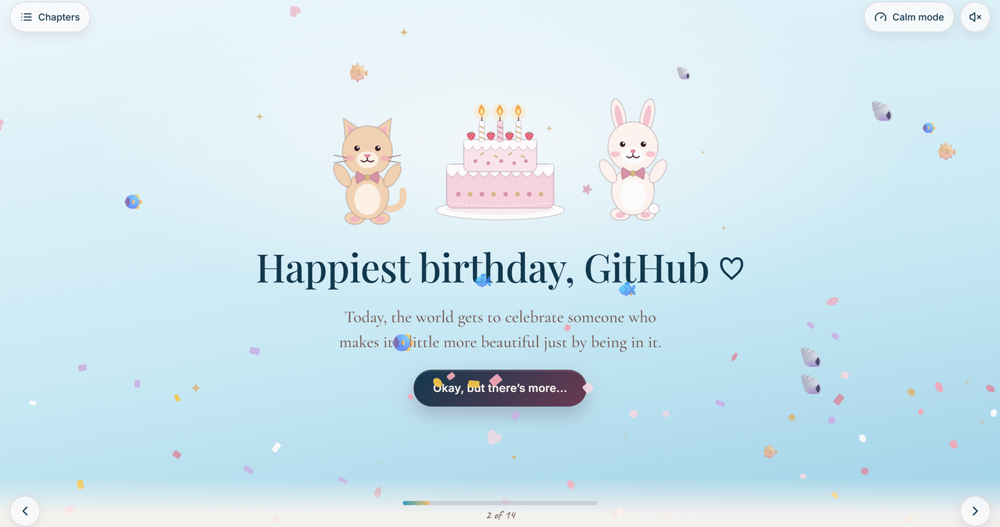
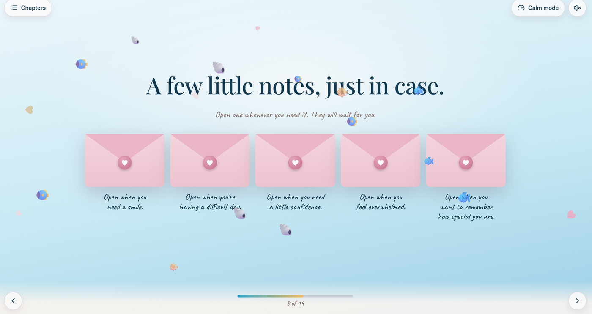
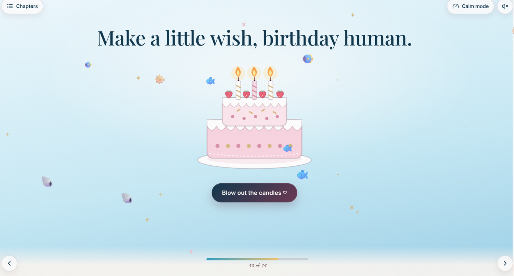
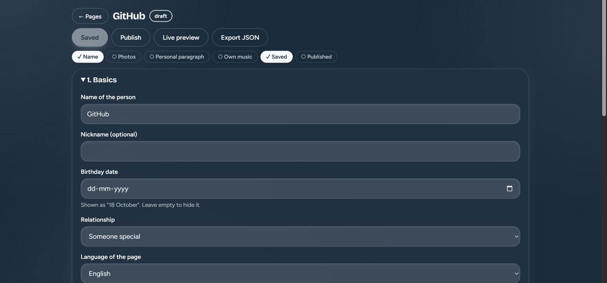
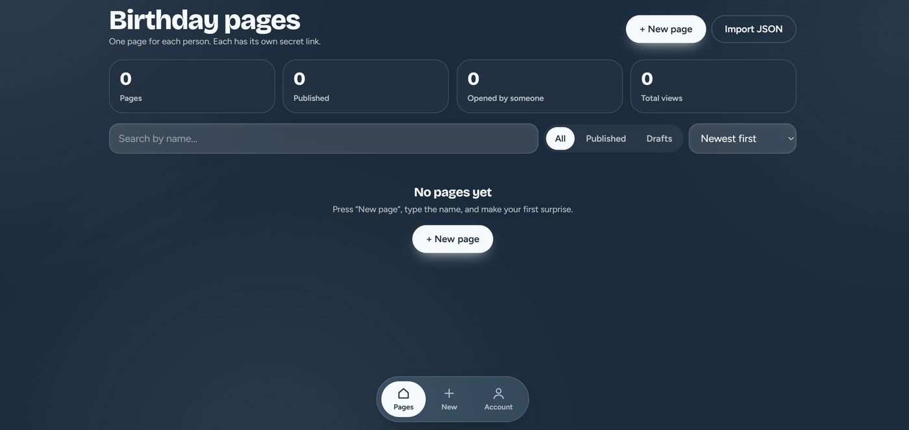

# Birthday Surprise

Website that makes a private birthday page for each person: 14 animated chapters, photos, music and wishes, with an admin panel to create and edit every page.

- **Status:** in progress
- **Live:** [happiiee-bday.vercel.app](https://happiiee-bday.vercel.app)
- **Built:** November 2026
- **Keywords:** React, TypeScript, Vite, Framer Motion, Supabase, PostgreSQL, Row Level Security, Vercel

## Highlights

- Built 14 chapters (opening, letters, gallery, games, cake, wishes, poems and more) that play one after another.
- Added 15 look packs (cat, dog, fish, mountain, ice, jungle, maple, anime, galaxy and 6 flower packs) that change colours and the floating decorations. The admin picks one per person.
- Built an admin panel: one page per person, photo and music upload, a ready-made library of English lines, and a share panel with a QR code.
- Locked each page behind a hard-to-guess link, with an optional PIN, a date when it opens and a date when it expires.
- Secured the admin with Supabase login, authenticator-app two-step code, forgot password and Row Level Security.

## Screenshots



Opening scene, shown with a test name ("GitHub").



Chapter 8: "open when" letters, with the fish and shell look pack.



Chapter 10: make a wish and blow out the candles.



Admin: editing one page. The checklist on top shows what is still missing.



Admin dashboard: counts, search, filters and the list of pages (empty state shown).

## Tech

- React 18, TypeScript and Vite: one single-page app for the admin and the birthday pages.
- Framer Motion: the chapter animations.
- Supabase (PostgreSQL, Auth, Storage): pages, photos and music are stored here, and the admin login runs on it.
- Vercel: hosts the built site.

## Run it

- Needs: Node 18 or newer, a free Supabase project
- Tested on: Windows, Chrome, live deploy on Vercel

```bash
git clone https://github.com/sachinkrcodes/birthday-surprise.git
cd birthday-surprise
npm install
copy .env.example .env.local
npm run dev
```

Before `npm run dev`: run `supabase/schema.sql` in the Supabase SQL Editor and put the project URL and the public anon key in `.env.local`. Full steps are in [docs/SETUP.md](docs/SETUP.md).

Then open http://localhost:5173/admin

## Hardest problem

- Problem: after I built the new admin, the live site still showed the old login page.

## Limits and next

- Not done: no automated tests.
- Next: add a custom e-mail sender and a short tutorial for new users of the admin.

## Author

Sachin Kumar | [GitHub](https://github.com/sachinkrcodes) | [LinkedIn](https://www.linkedin.com/in/sachinkrcodes) | Portfolio: [sachinkrcodes.vercel.app](https://sachinkrcodes.vercel.app) | sachinkrcodes@gmail.com

MIT License. See [LICENSE](LICENSE).
